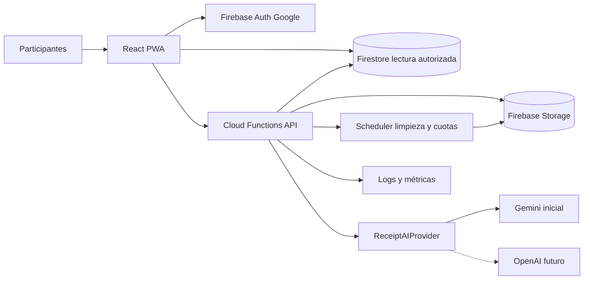
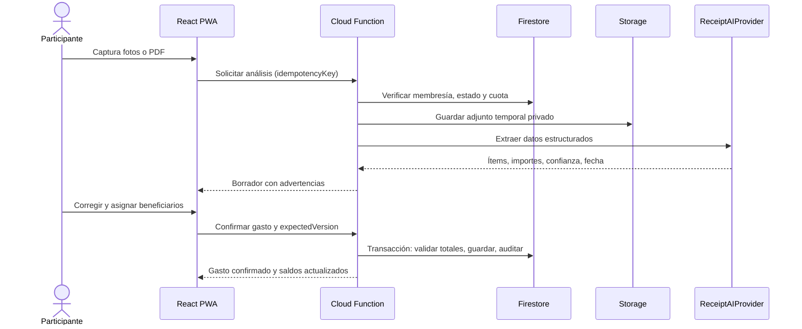
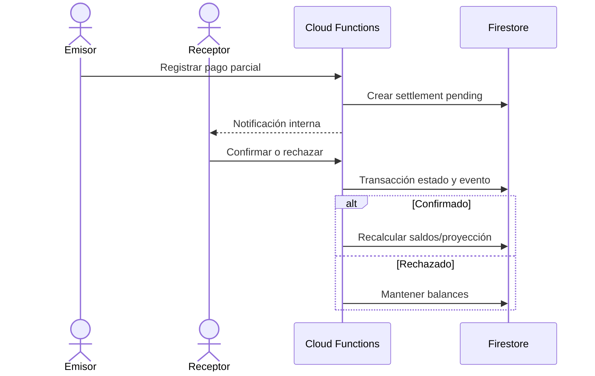
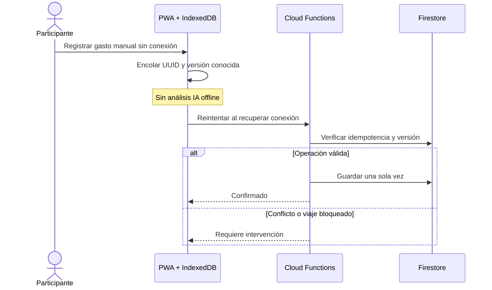
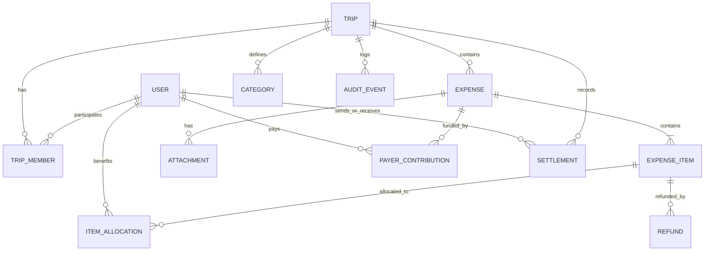

# PRD — Gastos de Viaje Colaborativos

**Versión:** 1.0  
**Fecha:** 13 de octubre de 2026  
**Estado:** Baseline de requisitos, pendiente de validación técnica y pruebas de aceptación  
**Stack:** React (PWA) + Firebase Authentication, Firestore, Cloud Functions, Storage + proveedor IA configurable (Gemini inicial)

## 1. Resumen ejecutivo

Aplicación colaborativa para registrar, distribuir, auditar y liquidar gastos de viajes. Cada viaje agrupa participantes autenticados con Google, facturas escaneadas por IA o gastos manuales, compras compartidas o personales, múltiples pagadores, devoluciones, pagos confirmados y dos vistas de deudas (originales y simplificadas). Los balances se calculan en una única moneda por viaje con precisión exacta en unidades menores.

### 1.1 Problema

Las compras grupales generan confusión cuando una persona paga por varias, una factura contiene productos consumidos por personas distintas, hay descuentos, propinas o devoluciones, y los pagos parciales se hacen en diferentes momentos. Las hojas de cálculo manuales son propensas a errores y exponen información privada.

### 1.2 Objetivos

1. Registrar una compra manual o por foto/PDF en pocos pasos.
2. Distribuir importes con exactitud verificable, incluso en facturas mixtas.
3. Mostrar saldos y propuestas de transferencias simplificadas sin alterar la contabilidad subyacente.
4. Respetar permisos y privacidad a nivel de documento, API y archivo.
5. Operar como PWA móvil con consulta y captura manual offline.

### 1.3 Métricas sugeridas (no comprometidas)

- Porcentaje de facturas IA guardadas tras corrección.
- Tiempo mediano de captura manual y por IA.
- Porcentaje de gastos cuyo total cuadra al primer intento.
- Incidentes de acceso no autorizado: objetivo cero.
- Porcentaje de pagos confirmados y viajes con saldos liquidados.

## 2. Alcance y exclusiones

**Incluido en MVP:** Google login; viajes y participantes; roles; gastos manuales y escaneados; asignaciones por producto; gastos personales/compartidos/mixtos; descuentos, impuestos, propinas; múltiples pagadores; deudas; pagos confirmados; devoluciones; reportes, exportaciones y auditoría; notificaciones internas; PWA; offline básico; archivado; privacidad; cuotas IA; retención de archivos; eliminación/anominización de cuenta.

**Excluido:** presupuestos, conversiones de divisas, pagos bancarios integrados, push/email, cuentas anónimas, pagadores externos, apps nativas, prorrateo diario de servicios, aceptación de cada gasto, aprobación individual de asignaciones y borrado definitivo de viajes.

## 3. Personas y roles

| Rol | Facultades principales |
|---|---|
| Creador del viaje | Invitar y gestionar participantes antes del primer gasto, asignar/revocar administradores, administrar gastos, categorías, cerrar/reabrir, archivar/restaurar. No pierde su rol. |
| Administrador | Ver todos los gastos, gestionar gastos y categorías, cerrar/reabrir; no puede asignar roles de administrador. |
| Participante | Registrar gastos, modificar los propios, ver detalles de gastos donde es pagador/beneficiario, ver balances de todos, registrar y confirmar/rechazar pagos según rol en transferencia. |
| Usuario eliminado | Sin acceso; historial financiero necesario permanece pseudonimizado, sujeto a política de privacidad. |
| Administrador técnico del sistema | Configura cuotas globales, proveedores de IA y operaciones; no obtiene automáticamente permiso para leer gastos personales sin justificación y controles explícitos. |

## 4. Catálogo de requisitos funcionales (56)

| ID | Requisito | Especificación verificable |
|---|---|---|
| RF-01 | Inicio de sesión Google | Firebase Auth con Google; gastos y acciones ligados al UID. |
| RF-02 | Múltiples viajes | Crear viajes con nombre, fechas y participantes; datos aislados por viaje e historial. |
| RF-03 | Invitaciones por correo | Invitar correos Google; aceptación tras autenticación y verificación de correo. |
| RF-04 | Registro colaborativo | Todos los participantes pueden registrar gastos; registrar creador y pagadores por separado. |
| RF-05 | Dos modos de reparto | Repartir importe total entre seleccionados o distribuir cada producto de una factura. |
| RF-06 | Extracción IA editable | Procesar foto, extraer ítems/cantidades/precios/total y permitir revisión antes de guardar. |
| RF-07 | Múltiples pagadores | Uno o varios pagadores participantes; suma de pagos de origen igual al total del gasto. |
| RF-08 | Moneda única | Una moneda por viaje, sin conversión automática. |
| RF-09 | Liquidaciones y optimización | Registrar pagos parciales/totales y calcular deudas netas con menos transferencias. |
| RF-10 | Edición restringida | Autor y creador pueden editar/borrar lógicamente; administradores adicionales según RF-34; auditoría. |
| RF-11 | Ajustes flexibles | Impuestos, propinas y descuentos repartidos proporcional, equitativa o manualmente. |
| RF-12 | Asignación flexible de ítems | Cada ítem por partes iguales, importe fijo o porcentaje; sumas exactas. |
| RF-13 | Comprobante opcional | Permitir gasto manual sin archivo y adjuntarlo posteriormente. |
| RF-14 | Categorías por viaje | Categorías iniciales y personalizadas; filtros y reportes por categoría. |
| RF-15 | Dashboard y filtros | Totales, aportes, consumo, deudas y gráficos; filtros por fecha/categoría/persona/pagador. |
| RF-16 | Cierre reversible | Cerrar manualmente y reabrir por creador/administrador; cerrado es solo lectura. |
| RF-17 | Offline básico | Consultar caché y crear gastos manuales sin conexión; sincronizar, indicar pendientes y evitar duplicados. |
| RF-18 | Notificaciones internas | Eventos de gastos, asignaciones y pagos, leído/no leído y navegación; sin push/email MVP. |
| RF-19 | Exportación Excel/PDF | Excel detallado y PDF resumen, sujetos a reglas de privacidad. |
| RF-20 | Participantes congelados | No modificar lista de participantes tras el primer gasto registrado. |
| RF-21 | Confirmación de pagos | Receptor confirma/rechaza pago; comprobante opcional; solo confirmados alteran saldos. |
| RF-22 | Advertencia duplicados | Señalar posible duplicado sin bloquear; idempotencia y confirmación explícita. |
| RF-23 | Servicios multidiarios | Registrar servicio de varios días como un solo gasto. |
| RF-24 | Sin presupuestos | No crear presupuestos ni alertas de presupuesto. |
| RF-25 | Accesos rápidos móviles | Botones prominentes «Escanear factura» y «Registro manual». |
| RF-26 | Incertidumbre IA | Resaltar campos dudosos; impedir guardar hasta cuadrar total; edición manual. |
| RF-27 | Asignación masiva | Seleccionar varios productos y asignar participantes en lote, luego ajustar individualmente. |
| RF-28 | Recalcular tras liquidaciones | Mostrar impacto previo de ediciones; pagos confirmados inmutables, saldos recalculados. |
| RF-29 | Eliminación lógica y restauración | Soft delete de gastos, excluidos del saldo; restaurar con vista previa e historial. |
| RF-30 | Múltiples adjuntos | Varias imágenes y PDF por gasto, soporte multipágina y control de duplicidad de páginas. |
| RF-31 | Fecha de transacción IA | Extraer fecha, permitir editar y usarla en informes; fecha de registro separada. |
| RF-32 | Pagadores internos | Solo participantes del viaje pueden figurar como pagadores. |
| RF-33 | Aceptación completa | Todos los invitados deben aceptar antes del primer gasto. |
| RF-34 | Varios administradores | Creador puede nombrar admins; admins gestionan gastos/categorías y cierre. |
| RF-35 | Gestión de admins exclusiva | Solo creador promueve/degrada admins; creador permanente. |
| RF-36 | Conflictos concurrentes | Versionado optimista y resolución explícita; también en sincronización offline. |
| RF-37 | Reembolsos por ítem | Devolución total/parcial por producto/cantidad; identificar receptor y limitar máximo reembolsable. |
| RF-38 | Privacidad de detalle | Participante normal ve detalle solo si es pagador/beneficiario; admin ve todo; reglas de backend/Storage/export. |
| RF-39 | Deudas visibles | Todos los participantes ven quién debe a quién y montos, sin revelar detalle privado. |
| RF-40 | Gastos personales separados | Tab/estadísticas aparte; no suman a total compartido; sí al global combinado. |
| RF-41 | Personal pagado por otro | Genera deuda pagador→beneficiario, sin clasificar el gasto como compartido. |
| RF-42 | Facturas mixtas | Una factura contiene ítems personales y compartidos; contabilidad y reportes separados. |
| RF-43 | Redondeo determinista | Calcular en enteros de unidad menor, distribuir residuos y cuadrar total. |
| RF-44 | Archivado reversible | Archivar viaje solo lectura, ocultar de activos, restaurar estado previo; sin borrado definitivo. |
| RF-45 | Descuentos mixtos | Descuento por ítem o ajuste general, ambos editables y conciliados. |
| RF-46 | Fechas fuera del viaje | Permitir gastos antes, durante y después del rango del viaje. |
| RF-47 | Aplicación inmediata | Gastos impactan balances al guardar; sin aprobación de asignados. |
| RF-48 | Dos vistas de deudas | Alternar original/simplificada; pagos confirmados incluidos; mismos saldos netos. |
| RF-49 | PWA instalable | React mobile-first, manifest, service worker, cámara y offline básico. |
| RF-50 | IA intercambiable | Contrato de proveedor, Gemini inicial, backend Cloud Functions, credenciales seguras. |
| RF-51 | Cuotas IA combinadas | Límites globales y por viaje, tamaño/reintentos, métricas por usuario/viaje/proveedor. |
| RF-52 | Caducidad de adjuntos | Eliminar archivos tras período fijo, conservar datos financieros y auditoría. |
| RF-53 | Retención seis meses | Borrar comprobantes seis meses desde carga, con aviso previo y trazabilidad. |
| RF-54 | Captura en moneda del viaje | Importes registrados solo en moneda oficial; conversiones externas son manuales. |
| RF-55 | Moneda inmutable | Bloquear cambio desde el primer gasto, incluso si luego se elimina. |
| RF-56 | Baja y anonimización | Eliminar acceso/datos personales aplicables, preservar integridad financiera con identidad anónima. |
| RF-57 | Ranking de deudores en tono de broma | Opcional por viaje (lo activa creador/admin, apagado por defecto); etiquetas fijas según saldo neto y relación «quién le debe a quién» en vista directa y simplificada; solo presentación, sin cambiar saldos. Añadido el 2026-10-15 (feature 007). |

## 5. Reglas de negocio y máquina de estados

### 5.1 Estados del viaje

- `pending`: invitaciones por aceptar; no se admiten gastos.
- `active`: todos aceptaron; gastos y liquidaciones permitidos.
- `closed`: lectura; admin/creador puede reabrir.
- `archived`: lectura, oculto de activos; creador restaura estado anterior.
- Una vez creado el primer gasto, `participantsLocked=true` y `currencyLocked=true`, incluso si se anula.
- Una invitación rechazada requiere que el creador resuelva la lista antes del primer gasto; no se crea un gasto mientras queden invitados sin aceptar.
- **Decisión pendiente:** si en viaje cerrado/archivado se admiten confirmaciones de pagos previamente iniciados; recomendación: bloquear mutaciones y exigir reapertura para evitar estados inconsistentes.

### 5.2 Cálculo financiero

Todos los importes persistidos son enteros en la unidad menor de la moneda (por ejemplo, centavos para USD; catálogo ISO 4217 para decimales). Nunca usar `float` para contabilidad.

Para cada gasto vigente `e`:

- `T(e) = suma(importe aportado por cada pagador)`.
- `T(e) = suma(cargo neto asignado a cada beneficiario)`.
- En factura mixta: `T(e) = suma(cargos personales) + suma(cargos compartidos)`.
- Los ajustes de impuestos, propinas y descuentos forman parte del neto final, sin duplicarse.
- Devoluciones generan movimientos compensatorios auditables, no mutan silenciosamente el comprobante original.
- `saldo_i = aportes_i − consumos_i + ajustes_por_devoluciones_i + pagos_confirmados_enviados_i − pagos_confirmados_recibidos_i` según convención contable implementada. Un saldo positivo es acreedor; negativo es deudor. La suma de todos los saldos debe ser cero.
- Pago pendiente/rechazado no cambia saldos. Pago confirmado es inmutable; cualquier reversión debe ser un movimiento compensatorio explícito (definir autorización en diseño detallado).
- La vista simplificada transforma saldos netos en propuestas de transferencias; no modifica gastos ni crea pagos por sí sola.

**Algoritmo determinista de redondeo:** calcular cuotas racionales, truncar a unidad menor, ordenar residuos descendentes y distribuir unidades restantes con desempate estable por `participantId`/`itemId`; documentar también asignaciones negativas (descuentos y devoluciones). Evitar cambios retroactivos del orden por reordenación visual.

**Ejemplo:** USD 10.00 entre 3 → USD 3.34, USD 3.33, USD 3.33. La suma es USD 10.00.

### 5.3 Reparto y privacidad

- Cada ítem tiene clase `personal` o `shared` y uno o más beneficiarios según el tipo.
- El pagador no necesariamente consume el producto.
- Participantes normales pueden ver el total agregado del viaje y el grafo de deudas; no deben inferir productos/adjuntos privados a través de búsquedas, notificaciones, exportaciones o agregados de granularidad excesiva.
- Administradores ven todos los gastos, sujetos a controles y auditoría.
- Los enlaces a comprobantes no serán públicos ni permanentes; acceso autorizado y expiración/descarga controlada.

### 5.4 Ediciones, concurrencia y auditoría

- Edición autorizada solo al autor, creador o administrador, y solo en viaje activo.
- Guardar con `expectedVersion`; si la versión actual cambió, devolver `CONFLICT` y mostrar diferencias.
- Antes de una edición que cambie deudas tras pagos confirmados, mostrar comparación de balances y solicitar confirmación.
- Borrado lógico/restauración produce una nueva versión y un evento de auditoría.
- Registrar actor, momento, acción, entidad, versión previa/nueva y cambios relevantes; proteger datos sensibles en logs.
- Las cuotas IA y deduplicación se validan en transacciones o mecanismo atómico resistente a concurrencia.

## 6. Historias de usuario y criterios de aceptación

| Historia | Como... quiero... para... | Criterios de aceptación resumidos |
|---|---|---|
| HU-01 | Viajero, iniciar sesión con Google | Solo identidad válida entra; UID persistente; logout revoca sesión local. |
| HU-02 | Creador, invitar compañeros | Viaje permanece `pending` hasta aceptación de todos; sin gastos antes. |
| HU-03 | Participante, registrar gasto manual | Puede guardar sin comprobante, con fecha fuera del rango del viaje, siempre en moneda del viaje. |
| HU-04 | Participante, escanear factura | Se detectan ítems y totales; incertidumbres se destacan; se permite editar; total cuadra antes de guardar. |
| HU-05 | Participante, asignar ítems | Soporta selección masiva y cuotas fijas/%/iguales; cuotas suman el neto de cada ítem. |
| HU-06 | Participante, registrar factura mixta | Ítems personales y compartidos en mismo comprobante; dashboard los separa. |
| HU-07 | Participante, dividir pagos entre varios | Solo miembros como pagadores; suma aportes = total; genera deudas correctas. |
| HU-08 | Participante, registrar liquidación | Emisor registra pago; receptor confirma/rechaza; solo confirmado impacta balances. |
| HU-09 | Participante, alternar vista de deudas | Vista original y simplificada conservan mismo saldo neto individual. |
| HU-10 | Autor/admin, corregir gasto | Se muestran diferencias si hay pagos confirmados; audit trail y control de versión. |
| HU-11 | Participante, solicitar devolución de ítem | No excede importe/cantidad disponible; identifica receptor; actualiza saldos. |
| HU-12 | Participante, trabajar offline | Gasto manual queda pendiente; se sincroniza una vez; conflictos no se sobreescriben silenciosamente. |
| HU-13 | Participante, exportar | Excel/PDF contienen solo detalles permitidos; deudas agregadas disponibles. |
| HU-14 | Creador, archivar/restaurar | Archivado es lectura; restaurar recupera estado previo. |
| HU-15 | Usuario, eliminar cuenta | Se retira acceso, anonimiza información personal aplicable, conserva balance histórico íntegro. |
| HU-16 | Administrador técnico, controlar IA | Solicitud sobre cuota se rechaza sin costo innecesario; registro manual sigue disponible. |

### 6.1 Escenarios Gherkin críticos

```gherkin
Scenario: Todos deben aceptar antes del primer gasto
  Given un viaje con 4 invitados y 1 pendiente
  When un participante intenta guardar un gasto
  Then el sistema rechaza la operación con TRIP_NOT_READY

Scenario: Factura compartida con redondeo exacto
  Given un gasto de USD 10.00 para tres beneficiarios por partes iguales
  When se confirma el reparto
  Then las cuotas son USD 3.34, USD 3.33 y USD 3.33 en orden estable
  And la suma de cuotas es USD 10.00

Scenario: Pago pendiente no afecta balances
  Given Ana debe USD 20.00 a Pedro
  When Ana registra un pago de USD 10.00 pendiente
  Then Ana sigue debiendo USD 20.00
  When Pedro confirma el pago
  Then Ana debe USD 10.00

Scenario: Conflicto de edición concurrente
  Given un gasto en versión 4
  When dos usuarios editan con expectedVersion 4
  Then una edición confirma versión 5
  And la otra recibe CONFLICT y puede revisar diferencias

Scenario: Usuario sin acceso al comprobante privado
  Given un gasto en el que Juan no es pagador ni beneficiario
  And Juan no es administrador
  When Juan solicita los ítems o el archivo
  Then la API deniega acceso
  And Juan puede consultar únicamente agregados autorizados

Scenario: Moneda congelada
  Given un viaje con primer gasto creado y luego anulado
  When el creador intenta cambiar USD a BOB
  Then el sistema rechaza el cambio
```

## 7. Arquitectura de solución

### 7.1 Componentes

- **Frontend:** React + TypeScript + Vite; React Router; TanStack Query o equivalente; React Hook Form + Zod; PWA manifest y service worker; IndexedDB para cola offline; internacionalización de moneda/fechas.
- **Autenticación:** Firebase Authentication, Google provider; App Check donde sea viable.
- **Base de datos:** Cloud Firestore, consultas indexadas, reglas de seguridad restrictivas.
- **Backend:** Cloud Functions 2nd gen en TypeScript; lógica financiera, permisos, transacciones, conciliación, notificaciones, auditoría, cuotas IA, exports y procesos programados.
- **Archivos:** Firebase Storage con rutas segregadas por viaje/gasto, reglas restrictivas, limpieza programada y metadatos de expiración.
- **IA:** `ReceiptAIProvider` con adaptadores `GeminiReceiptProvider` y futuro `OpenAIReceiptProvider`; salida tipada/validada con esquema; Secret Manager.
- **Observabilidad:** Cloud Logging, Error Reporting, métricas de costos/latencia/cuotas; minimizar datos personales en logs.
- **Hosting:** Firebase Hosting con HTTPS, rutas SPA y despliegues por entorno.

### 7.2 Diagrama C4 simplificado (contenedores)



**Decisión de seguridad:** las operaciones que afecten balances, pagos, devoluciones, roles, cuotas, anonimización y exportaciones pasan por Cloud Functions; evitar escrituras financieras directas desde cliente. Firestore Security Rules permiten únicamente lecturas autorizadas y escrituras cliente estrictamente delimitadas, si las hubiera.

### 7.3 Secuencia: factura con IA



### 7.4 Secuencia: liquidación



### 7.5 Secuencia: sincronización offline



## 8. Modelo de datos Firestore propuesto

> Modelo lógico inicial, no DDL definitivo. Los índices, límites de documento, patrones de lectura y costos deben validarse con prototipos. Guardar importes como enteros; mantener `schemaVersion` y `version`.

```text
users/{uid}
  displayName, email, photoURL, createdAt, deletedAt, anonymizedAt

trips/{tripId}
  name, startDate, endDate, currency, status, previousStatus
  creatorUid, participantsLocked, currencyLocked, firstExpenseAt
  createdAt, updatedAt, version

trips/{tripId}/members/{uid}
  uid, email, role: creator|admin|member
  invitationStatus: invited|accepted|declined
  invitedAt, acceptedAt, isAnonymized

trips/{tripId}/categories/{categoryId}
  name, color, isDefault, active, createdBy

trips/{tripId}/expenses/{expenseId}
  type: shared|personal|mixed
  categoryId, merchant, transactionDate, recordedAt
  totalMinor, currency, payerContributions[], status: active|deleted
  createdBy, version, attachmentIds[], source: manual|ai
  notes, idempotencyKey, createdAt, updatedAt, deletedAt

trips/{tripId}/expenses/{expenseId}/items/{itemId}
  description, quantityNumerator, quantityDenominator
  grossMinor, discountMinor, taxMinor, tipMinor, netMinor
  classification: shared|personal
  allocations[]: {uid, amountMinor, allocationMode}
  refundedQuantity, refundedMinor

trips/{tripId}/refunds/{refundId}
  expenseId, itemId, quantity, amountMinor, refundRecipientUid
  status, createdBy, createdAt, version

trips/{tripId}/settlements/{settlementId}
  fromUid, toUid, amountMinor, status: pending|confirmed|rejected
  proofAttachmentId, rejectionReason, createdAt, confirmedAt
  createdBy, version

trips/{tripId}/attachments/{attachmentId}
  expenseId, storagePath, mimeType, bytes, uploadedAt, expiresAt
  deletionStatus, deletedAt, checksum

trips/{tripId}/notifications/{notificationId}
  recipientUid, eventType, entityId, createdAt, readAt, safeSummary

trips/{tripId}/auditEvents/{eventId}
  actorUid, action, entityType, entityId, beforeVersion, afterVersion
  timestamp, redactedDiff, correlationId

trips/{tripId}/balanceSnapshots/{snapshotId}
  computedAt, sourceRevision, perMemberNetMinor, checksum

aiUsageGlobal/{periodKey}
  period, requests, tokenEstimate, budgetUnits, version

trips/{tripId}/aiUsage/{periodKey}
  requests, pages, bytes, provider, limit, version

idempotencyKeys/{scopeAndKey}
  actorUid, operation, resultRef, createdAt, expiresAt
```

### 8.1 Consideraciones del modelo

1. **No confiar en snapshots como fuente de verdad.** Los saldos se derivan de gastos, reembolsos y pagos confirmados; snapshots son proyecciones reconstruibles.
2. **Escalabilidad:** ítems en subcolección para evitar límites de tamaño de documento; si hay facturas grandes, pagadores y asignaciones podrían pasar también a subcolecciones.
3. **Privacidad RF-38:** no exponer `expenses` enteros a todos los miembros; construir vistas/consultas autorizadas o endpoints que filtren por pagador/beneficiario. Las reglas de Firestore no filtran campos dentro de un documento, por lo que los agregados públicos deben almacenarse por separado de los detalles privados.
4. **Usuarios anonimizados:** conservar claves contables internas no reversibles desde UI; no guardar email/nombre en snapshots, auditorías o notificaciones sin política explícita de limpieza.
5. **Pagos y deudas:** almacenar transferencias reales en `settlements`; propuestas simplificadas se calculan a demanda y no deben tratarse como obligaciones históricas adicionales.
6. **Retención:** `expiresAt = uploadedAt + 6 meses calendario` (definir zona/UTC y regla de fin de mes); scheduler idempotente; marcar estado de borrado y reintentar fallas.
7. **Invitaciones:** la identidad por email verificado se resuelve en backend, evitando que cualquier usuario se atribuya una invitación.
8. **Índices:** por `tripId`, `transactionDate`, `status`, `createdBy`, `recipientUid`, `readAt`, `expiresAt`; verificar índices compuestos de filtros combinados.

### 8.2 Esquema lógico de relaciones



## 9. API y servicios propuestos

| Operación | Endpoint lógico / función | Restricciones |
|---|---|---|
| Crear viaje | `createTrip` | Auth requerido; moneda ISO válida. |
| Invitar/aceptar | `inviteMember`, `acceptInvitation` | Solo creador invita; email verificado; congelación tras primer gasto. |
| Asignar admin | `setMemberRole` | Solo creador; no degradar creador. |
| Analizar comprobante | `analyzeReceipt` | Cuotas global/viaje, tipos y tamaño permitidos, autenticación, idempotencia. |
| Crear gasto | `createExpense` | Viaje activo, todos aceptados, conciliación, moneda, miembros. |
| Editar gasto | `updateExpense` | Autor/admin, `expectedVersion`, previsualización si aplica. |
| Anular/restaurar | `softDeleteExpense`, `restoreExpense` | Autorización y vista previa de impacto. |
| Reembolsar ítem | `createItemRefund` | Máximo reembolsable, validación transaccional. |
| Liquidar | `createSettlement`, `confirmSettlement`, `rejectSettlement` | Emisor/receptor correctos; confirmación única. |
| Ver balances | `getBalances` | Miembro del viaje; detalle según permisos. |
| Simplificar | `getSimplifiedTransfers` | Algoritmo determinista, solo propuesta. |
| Exportar | `exportTripExcel`, `exportTripPdf` | Export filtrado por permisos, enlace temporal. |
| Cerrar/archivar | `closeTrip`, `reopenTrip`, `archiveTrip`, `restoreTrip` | Creador/admin según RF, creador para archivo/restauración. |
| Eliminar cuenta | `requestAccountDeletion` | Confirmación explícita, job idempotente y anonimización. |

**Contrato IA sugerido:**

```typescript
interface ReceiptAIProvider {
  extract(input: {
    storagePaths: string[];
    locale?: string;
    currencyHint: string;
  }): Promise<ReceiptDraft>;
}

interface ReceiptDraft {
  merchant?: string;
  transactionDate?: string;
  detectedCurrency?: string;
  items: Array<{
    description: string;
    quantity: string;
    unitPriceMinor?: number;
    totalMinor?: number;
    confidence?: number;
  }>;
  subtotalMinor?: number;
  taxMinor?: number;
  tipMinor?: number;
  discountMinor?: number;
  totalMinor?: number;
  warnings: string[];
}
```

**Nota:** `detectedCurrency` se usa solo como advertencia en el borrador; RF-54 exige guardar el gasto en moneda del viaje, sin conversión automática.

## 10. Experiencia de usuario y pantallas

1. Login Google y onboarding.
2. Lista de viajes activos/cerrados y archivo.
3. Crear viaje: nombre, fechas, moneda, participantes.
4. Invitaciones y estado de aceptación.
5. Inicio de viaje: dashboard y botones «Escanear factura» / «Registro manual».
6. Escaneo/carga múltiple, borrador IA y corrección.
7. Editor de ítems: personal/compartido, asignación masiva, descuentos, pagadores y validación de total.
8. Detalle de gasto y adjuntos según permisos; historial de cambios.
9. Saldos: originales/simplificados, transferencias y pagos pendientes.
10. Confirmación/rechazo de pago y comprobante opcional.
11. Reembolsos por ítem.
12. Estadísticas y filtros; exportación Excel/PDF.
13. Categorías, administradores, cerrar/reabrir, archivar/restaurar.
14. Centro de notificaciones y ajustes de cuenta/baja.
15. Indicador offline y cola de sincronización con resolución de conflictos.

**Principios UX:** mostrar moneda y total en cada paso; advertir discrepancias; hacer visibles los ítems sin beneficiarios; indicar cuando un gasto es privado; pedir confirmación antes de cambios con impacto financiero.

## 11. Requisitos no funcionales

| Área | Requisito propuesto / validación |
|---|---|
| Seguridad | Firebase Auth, Security Rules deny-by-default, App Check cuando sea aplicable, secretos en Secret Manager, Cloud Functions con autorización servidor. |
| Privacidad | Datos detallados solo a autorizados; agregados no revelan ítems privados; exports filtrados; enlaces temporales; política de baja. |
| Integridad | Importes enteros; invariantes de suma; transacciones; versionado; idempotencia; auditoría. |
| Disponibilidad | Modo online normal; offline limitado a caché y captura manual; cola recuperable. |
| Rendimiento | Objetivos iniciales a validar: pantalla principal usable en <3 s en red móvil razonable; operaciones financieras <2 s p95 excluyendo IA. |
| Escalabilidad | Índices compuestos, paginación, documentos pequeños, proyecciones incrementales reconstruibles. |
| Costos | Alertas presupuestarias de Firebase/GCP, cuotas IA y límites de tamaño; métricas por viaje. |
| Accesibilidad | Navegación por teclado, labels accesibles, contraste adecuado, mensajes de error claros. |
| Compatibilidad | Chrome Android y Safari iOS recientes; degradación elegante de cámara, instalación y offline. |
| Observabilidad | Correlation IDs, logs estructurados sin datos privados, alertas de fallos de jobs/IA. |
| Recuperación | Estrategia de backup/restore Firestore y pruebas de restauración antes de producción. |
| Cumplimiento | Política de privacidad, consentimiento y retención sujetos a revisión legal según jurisdicciones. |

## 12. Estrategia de pruebas

### 12.1 Unitarias (motor financiero)

- Reparto equitativo y residual (1 centavo entre N personas).
- Porcentaje/fijo/igual con productos y ajustes generales.
- Descuentos por ítem y descuento general sin doble aplicación.
- Factura mixta personal/compartida.
- Varios pagadores, uno de ellos beneficiario de parte del gasto.
- Devoluciones parciales sucesivas sin exceder máximo.
- Pagos pendientes/rechazados/confirmados; cambios posteriores en gasto.
- Simplificación que preserva saldo neto, incluyendo ciclos de deuda.
- Soft delete/restauración; saldos globales suman cero.
- Pruebas basadas en propiedades con importes aleatorios y muchos participantes.

### 12.2 Integración y seguridad

- Firebase Emulator Suite para reglas Firestore/Storage y Cloud Functions.
- Usuario no involucrado no puede obtener detalle ni URL de comprobante.
- Admin ve detalles pero no puede promover admins.
- Invitación no aceptada bloquea primer gasto.
- Bloqueo permanente de moneda/participantes tras primer gasto.
- Dos solicitudes simultáneas con misma clave idempotente crean un solo gasto.
- Conflicto de versiones no sobreescribe cambios.
- Cuota IA simultánea no excede límite.
- Borrado de archivo vencido conserva balance.
- Baja de cuenta elimina datos personales en índices/proyecciones/adjuntos según política.

### 12.3 E2E / dispositivos

- Flujo completo: crear viaje → aceptar invitaciones → escanear → asignar → liquidar → exportar → archivar.
- iOS Safari: instalación PWA, permisos de cámara, carga de PDF, reconexión.
- Android Chrome: captura, compartir archivo, offline y sincronización.
- Exportación respetando permisos; notificaciones con enlaces seguros.

## 13. Roadmap de implementación

Las fases indican dependencias y entregables, **no fechas comprometidas**.

| Fase | Entregables | Criterio de salida |
|---|---|---|
| 0. Diseño y cimientos | Repositorio, CI/CD, Firebase por entornos, contratos TypeScript, threat model, reglas iniciales, wireframes, motor financiero y tests. | Emuladores funcionando, invariantes financieras automatizadas. |
| 1. Identidad y viajes | Google Auth, creación, invitaciones/aceptación, roles, moneda fija, estados de viaje. | Viaje activo solo con todos aceptados; reglas de roles probadas. |
| 2. Gastos manuales y balances | Gastos, ítems, pagadores, personal/compartido/mixto, descuentos, dashboard básico, auditoría. | Ejemplos complejos cuadran al centavo; privacidad validada. |
| 3. Liquidaciones y cambios | Pagos confirmados, devoluciones, vista simplificada, soft delete, conflictos y previsualización de impacto. | Reconciliación y escenarios de concurrencia superados. |
| 4. IA y adjuntos | Storage, carga múltiple/PDF, Gemini vía proveedor, edición de borrador, cuotas, expiración 6 meses. | Extracción y corrección completas; cuota y limpieza probadas. |
| 5. PWA y colaboración | Offline básico, notificaciones internas, filtros, categorías, cierre/archivo, export Excel/PDF. | E2E Android/iOS y export seguro. |
| 6. Hardening y piloto | Rendimiento, seguridad, backups, accesibilidad, costos, anonimización, pruebas de usuario. | Checklist de lanzamiento y aprobación de stakeholders. |

### 13.1 Priorización técnica

- **Crítico antes de producción:** permisos RF-38, integridad RF-43, concurrencia RF-36, idempotencia, pruebas de pagos/devoluciones, cuotas y borrado seguro de adjuntos.
- **Riesgo principal:** privacidad granular con Firestore y reportes agregados; resolver el patrón de lectura desde Fase 0.
- **Riesgo de producto:** exactitud de OCR/IA en recibos variados; siempre ofrecer corrección y registro manual.
- **Riesgo operativo:** costo de lecturas y agregaciones en Firestore; prototipar proyecciones y paginación.

## 14. Decisiones pendientes y aclaraciones

No son requisitos adicionales aprobados; deben resolverse antes de desarrollo final:

1. **Estado cerrado:** ¿pueden confirmarse pagos ya pendientes o es necesaria reapertura?
2. **Política de borrado de cuenta:** tratamiento de comprobantes que contengan nombres, tarjetas u otros datos personales; conservación legal y derechos de terceros.
3. **Notificación de expiración:** cuántos días antes del vencimiento de seis meses y a qué usuarios autorizados.
4. **Reembolsos:** cómo distribuir descuentos/impuestos originales en devoluciones parciales y quién puede autorizarlas.
5. **Pago confirmado erróneo:** procedimiento de reversión mediante contraasiento y permisos.
6. **Archivo:** confirmar si solo creador puede archivar/restaurar (propuesta actual) y si admins pueden restaurar gastos borrados.
7. **Datos personales vs balances públicos:** evaluar riesgos de inferencia por agregados de muy pocos miembros.
8. **Política de cuotas:** valores numéricos por día/mes, por viaje, por archivo y comportamiento al agotarse.
9. **Conversión manual:** al recibir factura en otra moneda, aclarar cómo se editan los ítems para que cuadren en la moneda del viaje.
10. **PWA offline:** límites concretos de almacenamiento, expiración de caché y conflictos tras cambios de permisos.
11. **Exportación PDF/Excel:** formatos de resumen y nivel de detalle por rol; el acceso de admins no debe generar archivos públicos.
12. **Monedas sin decimales:** catálogo ISO 4217 y reglas de presentación según moneda.

## 15. Definición de terminado del MVP

- Los 56 RF tienen implementación o exclusión expresamente aceptada en un plan de entregas.
- Todos los escenarios críticos financieros y de permisos pasan en CI.
- No hay diferencias entre total de pagos de origen, consumo asignado y gasto neto.
- La suma de saldos por viaje es cero; la simplificación conserva saldos.
- Se valida la privacidad desde cliente, API, Firestore, Storage y exportaciones.
- La PWA puede instalarse en Android/iOS compatibles; registro manual offline se recupera sin duplicación.
- El sistema procesa facturas con Gemini y permite corrección total; caída de IA no impide registrar gastos manuales.
- Se verifica eliminación de comprobantes vencidos a seis meses y anonimización de cuenta.
- Se documentan costos operativos, monitoreo, backups y recuperación.

---

**Fin del PRD v1.0.** Este documento consolida los 56 requisitos acordados; las propuestas técnicas y decisiones pendientes están marcadas como tales para no confundirlas con decisiones ya aprobadas.
